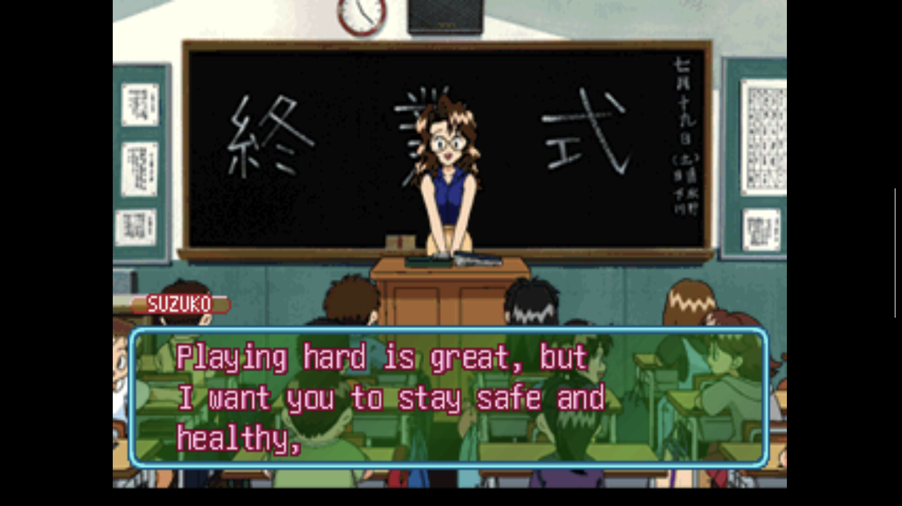
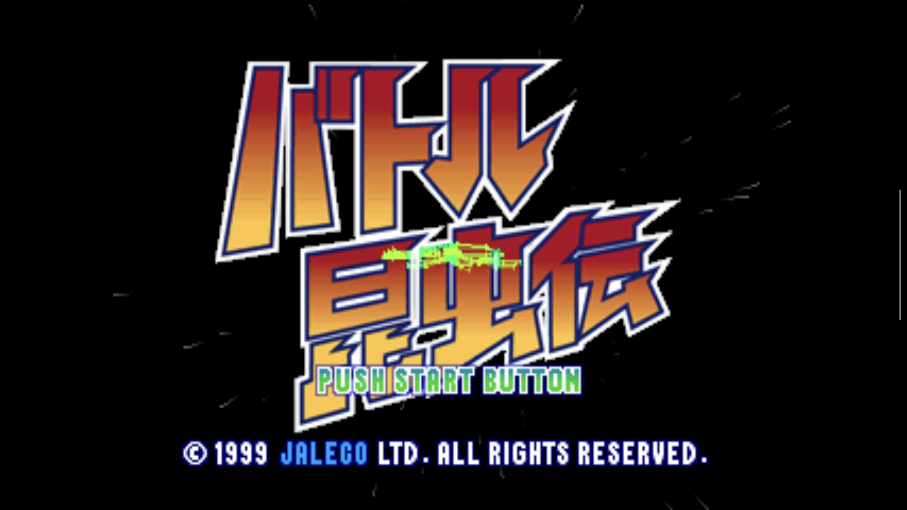
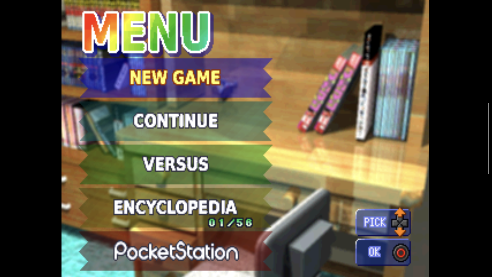
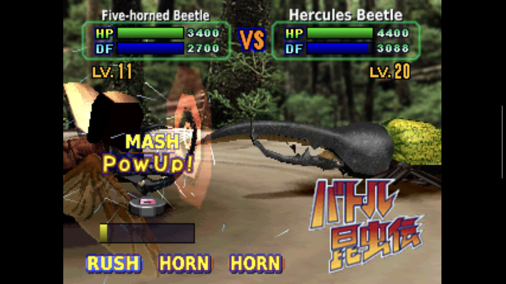
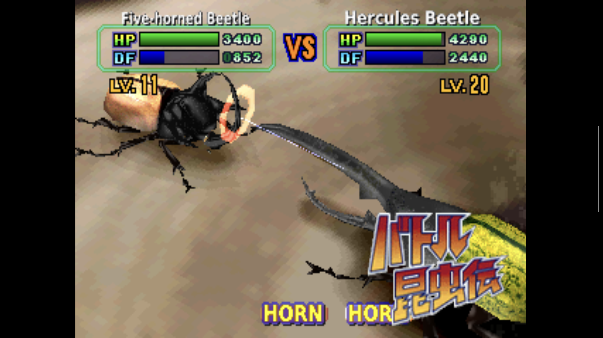
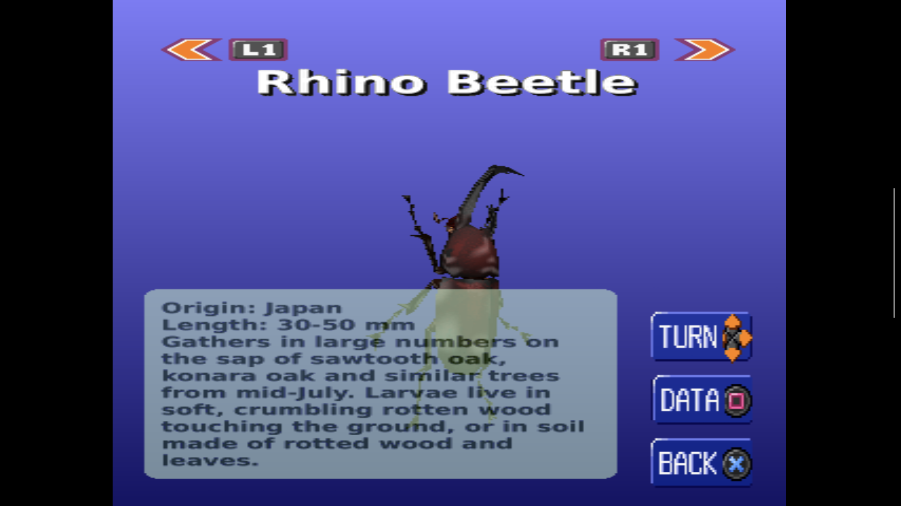

# Screenshots

The following screenshots showcase the English translation of *Battle Konchūden* running in an emulator.

They illustrate different aspects of the game, from dialogue and menus to insect battles and encyclopedia entries.

## Dialogue

## Menus and interface

**Title screen**

**In-game menu**

## Insect battles

## Insect encyclopedia

---

[Back to the main project page](../README.md)

All screenshots were captured from the game running with the English translation patch applied.
